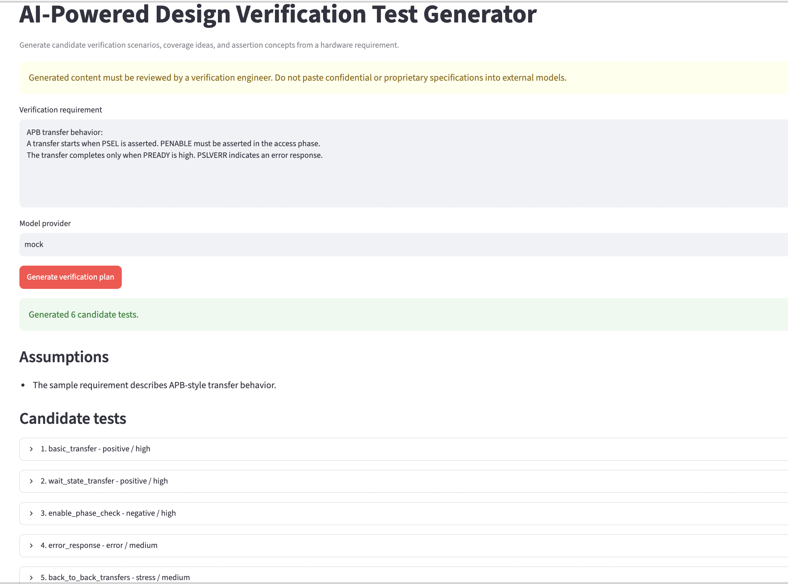

# AI-Powered Design Verification Test Generator

[](https://github.com/Sindhugd6472/AI-DV-test-generator/actions/workflows/ci.yml)


**AI-assisted verification planning for hardware/IP requirements.**

This project converts a natural-language hardware requirement into a structured candidate verification plan with test scenarios, priorities, expected behavior, functional-coverage ideas, and candidate assertion concepts.

It is designed as a **human-in-the-loop verification aid**: generated content is reviewed by an engineer before it is used in a real verification environment.

## Demo



## Project overview

Design verification requires engineers to translate specifications into verification intent, tests, coverage goals, and assertions. This project explores how an LLM can assist that planning process while preserving engineering review and technical accountability.

The current version focuses on three goals:

- convert requirements into structured verification scenarios
- generate candidate coverage and assertion ideas
- validate AI output before presenting or exporting it

## Example input

```text
A transfer starts when PSEL is asserted.
PENABLE must be asserted in the access phase.
The transfer completes only when PREADY is high.
PSLVERR indicates an error response.
```

## Example generated scenarios

The tool can propose candidate tests such as:

- basic read/write transfer behavior
- delayed PREADY and wait-state handling
- setup-to-access sequencing
- error-response handling
- back-to-back transfers
- completion-condition coverage
- candidate SVA concepts

Each generated test includes:

| Field | Purpose |
|---|---|
| Test name | Short scenario identifier |
| Objective | Behavior being verified |
| Category | Positive, negative, boundary, error, stress, or coverage |
| Priority | High, medium, or low |
| Preconditions | Required setup |
| Stimulus | Ordered verification actions |
| Expected result | Observable expected behavior |
| Coverage points | Candidate functional-coverage ideas |
| Assertion ideas | Candidate SVA concepts |
| Rationale | Why the scenario matters |

## Architecture

```text
Hardware / IP Requirement
          |
          v
    Prompt Builder
          |
          v
   LLM Provider Layer
   /              \
Mock Provider   OpenAI Provider
   \              /
          v
    Structured JSON
          |
          v
  Pydantic Validation
          |
          v
   Verification Plan
      /         \
 Streamlit UI   CLI
      |
      +--> JSON export
      +--> CSV export
```

## Technical highlights

- Python-based modular architecture
- provider abstraction for offline and model-backed generation
- Pydantic schema validation for structured AI output
- Streamlit interface for interactive use
- JSON and CSV export
- pytest unit tests
- GitHub Actions CI
- verification-focused prompt construction
- explicit assumptions and engineering guardrails

## Quick start

### 1. Clone the repository

```bash
git clone https://github.com/Sindhugd6472/AI-DV-test-generator.git
cd AI-DV-test-generator
```

### 2. Create a virtual environment

macOS/Linux:

```bash
python -m venv .venv
source .venv/bin/activate
```

Windows PowerShell:

```powershell
python -m venv .venv
.venv\Scripts\Activate.ps1
```

### 3. Install dependencies

```bash
pip install -r requirements.txt
```

### 4. Run the app

```bash
streamlit run app.py
```

The application defaults to the deterministic `mock` provider, so it can be run without an API key.

## Optional model-backed mode

Copy `.env.example` to `.env` and configure:

```text
MODEL_PROVIDER=openai
OPENAI_API_KEY=your_key_here
OPENAI_MODEL=gpt-6-luna
```

Then run:

```bash
streamlit run app.py
```

Never commit a `.env` file or API key.

## Why mock mode is included

The offline mock provider makes the project:

- reproducible without external services
- easy to run during review
- suitable for automated CI testing
- usable without API cost or credentials

It exercises the same schema, validation, UI, and export path as the model-backed flow.

## Project structure

```text
AI-DV-test-generator/
├── app.py
├── cli.py
├── requirements.txt
├── pyproject.toml
├── .env.example
├── src/
│   ├── __init__.py
│   ├── generator.py
│   ├── llm.py
│   ├── models.py
│   ├── prompts.py
│   └── validators.py
├── sample_requirements/
│   └── apb_requirement.md
├── tests/
│   ├── test_generator.py
│   └── test_validators.py
└── .github/
    └── workflows/
        └── ci.yml
```

## Engineering guardrails

LLMs can hallucinate protocol behavior, invent unsupported corner cases, or produce invalid assertions. This project therefore:

- preserves the original requirement
- records assumptions explicitly
- validates output against a strict schema
- labels assertion ideas as candidates
- requires human engineering review
- defaults to an offline provider
- warns against sending confidential specifications to external services

**Do not paste proprietary employer specifications, internal IP documentation, or confidential design information into this project or any external model.**

## Testing and CI

Unit tests cover:

- deterministic mock generation
- JSON and CSV export
- rejection of malformed model output
- schema validation of valid verification plans

GitHub Actions runs the test suite automatically on pushes and pull requests.

## Roadmap

Planned extensions include:

- requirement-to-test traceability
- specification section IDs
- UVM sequence skeleton generation
- candidate SVA generation with syntax checks
- duplicate scenario detection
- coverage-gap-driven test suggestions
- simulator feedback
- regression-result feedback
- local-model support

## Status

**Working prototype**

The current version provides an end-to-end AI-assisted verification planning workflow with structured test generation, validation, JSON/CSV export, a Streamlit interface, automated tests, and CI.

The project intentionally focuses on **human-reviewed verification planning** rather than autonomous RTL verification.
